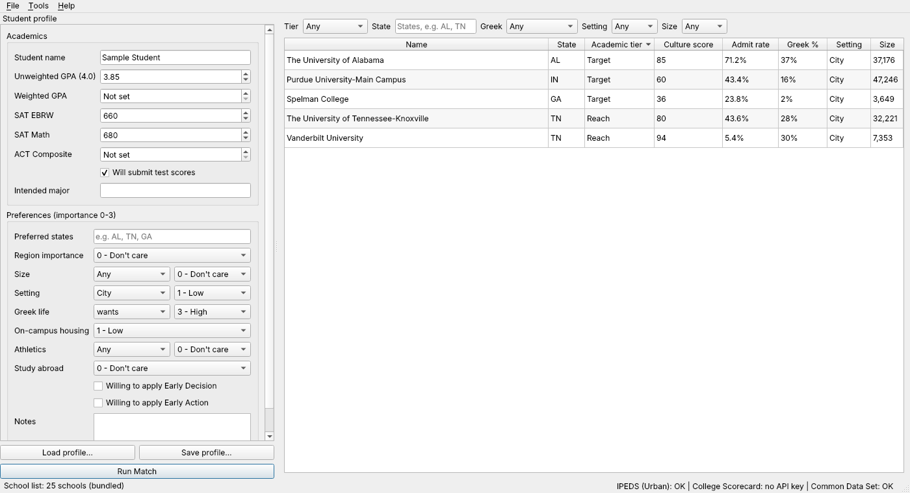

# College Fit Advisor

A Windows desktop app for college advisors. Enter a student's profile and get every school in the
registry ranked two ways:

- **Academic fit** — Safety / Target / Reach from the admit rate, the school's GPA distribution and its
  SAT/ACT middle 50 %, with the reasoning shown.
- **Culture fit** — Greek life, setting, size, housing, athletics, region and study abroad, weighted by
  what the student cares about.



**No college data ships with the app.** Everything is fetched live from official sources and held in
memory for the session only:

| Source | Used for |
|---|---|
| IPEDS via the [Urban Institute Education Data Portal](https://educationdata.urban.org/) | directory, setting, admissions counts, test ranges, retention, graduation, athletics |
| [College Scorecard](https://collegescorecard.ed.gov/data/documentation/) (free API key) | undergraduate size and fallbacks |
| Each school's own **Common Data Set** (PDF/XLSX on its `.edu` site) | GPA distribution, ED/EA, Greek life, housing, admission factors, test policy |

Niche, Peterson's, BigFuture and College Transitions are **link-outs only** (their terms forbid
automated collection). Details: [docs/DATA_SOURCES.md](docs/DATA_SOURCES.md).

## Install (Windows)

Download `CollegeFitAdvisor-win64.zip` from [Releases](https://github.com/mpromisel002/CollegeIQDashboard/releases),
unzip, run `CollegeFitAdvisor.exe`. The exe is not code-signed yet, so SmartScreen will warn:
choose **More info → Run anyway**. (Code signing is a later, paid step.) See
[docs/USER_GUIDE.md](docs/USER_GUIDE.md).

## Development

```bash
python -m venv .venv && .venv\Scripts\activate      # Python 3.12, 64-bit
pip install -r requirements-dev.txt
set PYTHONPATH=src
python -m cfa                                        # open the app
python -m cfa --self-test                            # load registry, ping sources, exit 0/1
pytest                                               # offline: recorded fixtures only
ruff check src tests && mypy src
python -m cfa.tools.validate_registry                # check every registry link + parse
python -m cfa.tools.live_smoke --baseline docs/coverage_baseline.json   # real sources
pyinstaller packaging/cfa.spec --noconfirm           # build dist/CollegeFitAdvisor/
```

On Linux, Qt needs `libegl1 libgl1 libxkbcommon0`; tests run with `QT_QPA_PLATFORM=offscreen`.

Set `CFA_SCORECARD_API_KEY` in the environment, or save the key in *Tools → Settings*.

### Layout

```
src/cfa/            app.py, config.py, pipeline.py, aggregate.py, cache.py
  models/           FieldValue, CollegeRecord, StudentProfile
  sources/          http client, Urban/IPEDS, Scorecard, registry loader
  sources/cds/      fetch, PDF/XLSX → layout rows, section extractors (C1 … F1, B22)
  scoring/          academic (tiers), culture (0-100)
  ui/               PySide6 window, results table, detail view, charts, settings
  tools/            validate_registry, live_smoke
registry/schools.yaml   pointers only (UnitIDs + CDS URLs); mirrored to the public
                        mpromisel002-CollegeIQDashboard-registry repo the app reads (see docs/ADDING_SCHOOLS.md)
tests/              unit, adapters (respx), parsers (real CDS samples), ui (pytest-qt)
```

### Releases

Push a tag `v*` (for example `v0.1.0`). `.github/workflows/release.yml` runs the tests on
`windows-latest`, builds with PyInstaller, smoke-launches the exe with `--self-test`, and attaches
`CollegeFitAdvisor-win64.zip` to the GitHub Release. Every CI run on a PR also uploads the zip as a
build artifact.

`.github/workflows/live-smoke.yml` runs weekly against the real sources and opens an issue when a
source health check fails, a registry link breaks, or coverage drops more than 10 % below
`docs/coverage_baseline.json`.

## License

Proprietary — all rights reserved. See [LICENSE](LICENSE).
